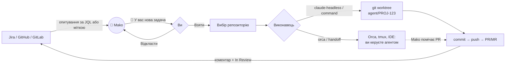

# 🦈 Mako

**Нова задача в трекері → сповіщення на десктопі → один клік → над нею працює ваш AI-агент.**

Mako — локальний демон, який стежить за задачами в **Jira**, **GitHub Issues** і **GitLab Issues**.
Коли зʼявляється задача для агента, на десктопі виринає сповіщення **«🦈 У вас нова задача»**
з кнопками **Взяти** і **Відкласти**. Взяті задачі Mako віддає агенту на вашому компʼютері: у **вбудований термінал**,
де ви бачите Claude і можете втрутитися будь-коли, у фоновий Claude Code, Orca, Codex або будь-яку іншу команду.
Кожна задача виконується в окремому git worktree, тож ваша робоча копія лишається недоторканою.

> Mako — найшвидша акула. Помічає задачу першою і віддає її тому, хто її зробить.

## Можливості

- **Трекери на вибір:** Jira (Cloud), GitHub Issues (зокрема Enterprise), GitLab Issues (зокрема self-hosted). Можна кілька одночасно.
- **Ви вирішуєте, що брати:** нативні сповіщення з кнопками на macOS, Windows і Linux, а також локальна сторінка «Вхідні» на випадок, якщо сповіщення пропущене.
- **Вбудований термінал:** агент працює в терміналі прямо у вебінтерфейсі Mako. Ви бачите кожен крок, відповідаєте на питання,
  погоджуєте дозволи. Коли агенту потрібна ваша участь, приходить сповіщення. Окремі інструменти на кшталт Orca не потрібні.
- **Не привʼязаний до інструмента:** агента запускає «виконавець», і його можна вибрати для кожного репозиторію окремо.
- **WIP-ліміт як у канбані:** наприклад, не більше 2 задач у роботі. Поки ліміт заповнений, Mako не опитує трекер.
- **Ізоляція:** окремий worktree і гілка `agent/<задача>` на кожну задачу, кілька агентів працюють паралельно.
- **Маршрутизація:** одна Jira на кілька репозиторіїв, з вибором за міткою `repo:<назва>`, компонентом або правилами.
- **Повний цикл:** статус «In Progress» на старті, push, PR/MR з `Closes #N`, підсумок агента в коментарі, «In Review» наприкінці.
- **Стійкість до перезапусків:** стан зберігається на диску, відкладені задачі не губляться, перервані повертаються в чергу.

## Як це працює



1. Mako раз на хвилину питає трекер, чи є нові задачі для агента.
2. Про кожну нову задачу ви отримуєте сповіщення. У ньому видно, куди піде задача, наприклад `Jira → web · Claude Code`.
3. «Взяти» ставить задачу в чергу. «Відкласти» або проігнороване сповіщення: Mako спитає знову через годину.
4. Задача переходить в In Progress, Mako створює worktree від свіжого `origin/main` і запускає агента з промптом,
   зібраним із назви, опису й коментарів задачі.
5. Коли агент закінчив, Mako пушить гілку, відкриває PR/MR, пише підсумок у задачу і переводить її в In Review.

## Швидкий старт

**Потрібно:** Node.js 20.12+, `git` і агент. За замовчуванням це [Claude Code](https://docs.anthropic.com/en/docs/claude-code)
з виконаним входом. Для PR у GitHub ще потрібен `gh` з виконаним `gh auth login`.
На Linux для вбудованого термінала потрібні `make` і `g++`, бо `node-pty` компілюється при встановленні;
для macOS і Windows є готові бінарники.

```bash
git clone https://github.com/SergeyPirogov/mako-agent && cd mako-agent
npm install
npm run dev
```

При першому запуску конфігу ще немає, тож Mako відкриває в браузері сторінку **Налаштування**
(http://127.0.0.1:7777/settings):

1. **Трекер.** Натисніть «+ Jira», «+ GitHub» або «+ GitLab» і вкажіть, які задачі брати (JQL або мітку).
2. **Проєкт → репозиторій.** Вкажіть ключ проєкту (або `owner/repo`) і шлях до локального клону.
3. **Секрети.** Вставте токен. Він зберігається лише у вашому `.env`.
4. **«Перевірити підключення»** покаже, скільки задач Mako бачить.
5. **«Зберегти».** Mako одразу почне працювати, перезапуск не потрібен.

Потім повісьте мітку `claude-agent` на будь-яке issue (або задачу, що підпадає під JQL) і дочекайтеся сповіщення.

Сторінка лише записує `mako.config.json` і `.env`, тож усе можна редагувати й вручну.
Повний приклад лежить у [`mako.config.example.json`](mako.config.example.json), а перевірити конфіг без змін можна так:

```bash
npm run dev -- --dry-run
```

## Життєвий цикл задачі

| Стан | Що відбувається |
|---|---|
| **Нова** | Задачу знайдено, на екрані сповіщення з кнопками |
| **Відкладена** | Ви натиснули «Відкласти» або проігнорували сповіщення. Через `snoozeMin` хвилин Mako спитає знову |
| **У черзі** | Ви натиснули «Взяти». Агент стартує, щойно звільниться слот (`maxConcurrent`) |
| **Виконується** | Статус In Progress або мітка `agent:in-progress`, працює виконавець |
| **Передано** | Задачу відкрито в Orca, tmux тощо, і нею керуєте ви. Mako чекає PR/MR з гілки задачі |
| **Готово** | Є PR/MR, підсумок у коментарі, статус In Review або мітка `agent:done`, сповіщення ✅ |
| **Помилка** | Коментар із причиною, мітка `agent:failed`, сповіщення ❌, кнопка «Повторити» у «Вхідних» |

## Конфігурація

Найпростіше налаштовувати через сторінку **Налаштування** (http://127.0.0.1:7777/settings): там є всі параметри нижче,
перевірка підключення до трекера, а зміни застосовуються без перезапуску. Під капотом конфіг лежить у `mako.config.json`
(інший файл можна вказати через `-c`), секрети в `.env`.

### Загальні параметри

| Параметр | За замовчуванням | Що означає |
|---|---|---|
| `pollIntervalSec` | `60` | Як часто опитувати трекери |
| `wipLimit` | `0` (без ліміту) | Максимум задач у роботі, див. [WIP-ліміт](#wip-ліміт) |
| `maxConcurrent` | `wipLimit` або `1` | Скільки агентів працюють одночасно (стосується лише виконавців, яких Mako чекає) |
| `taskTimeoutMin` | `45` | Ліміт часу на одну задачу |
| `handoffCheckMin` | `5` | Як часто шукати PR для переданих задач, `0` вимикає |
| `stateDir` | `.mako` | Стан (`state.json`), логи агентів і промпти |
| `defaultExecutor` | перший у `executors` | Виконавець для репозиторіїв без власного `executor` |

### WIP-ліміт

Як у канбані: Mako тягне нову роботу, лише коли є вільне місце.

```json
"wipLimit": 2
```

- **«В роботі»** — це взяті задачі в черзі, ті, що виконуються, і передані в Orca чи tmux, поки для них не зʼявився PR.
- **Ліміт заповнений:** Mako взагалі не звертається до трекерів. Нових сповіщень немає, задачі чекають у трекері.
  Перевірка PR для переданих задач триває, бо саме вона звільняє місце.
- **Є вільні місця:** Mako пропонує рівно стільки задач, скільки місць, у порядку трекера
  (для Jira порядок задає `ORDER BY` у JQL, тож пріоритетні йдуть першими). Задача, про яку висить сповіщення, тримає місце.
  Якщо її відкласти чи проігнорувати, місце дістається наступній.
- У «Вхідних» видно лічильник «В роботі: 1 / 2». Кнопка «Взяти» там працює і понад ліміт: це ваше свідоме рішення.

### Трекери

Масив `trackers` може містити кілька трекерів, зокрема одного типу. Тоді кожному потрібен свій `id`.

| `type` | Які задачі беруться | Як позначається прогрес | Ключ у `projects` | Секрети в `.env` |
|---|---|---|---|---|
| `jira` | За `jql` | Статуси з `transitions` | Ключ проєкту: `PROJ` | `JIRA_BASE_URL`, `JIRA_EMAIL`, `JIRA_API_TOKEN` |
| `github` | Відкриті issues з міткою `labels.trigger` | Мітки | `owner/repo` | `GITHUB_TOKEN` або `gh auth login` |
| `gitlab` | Відкриті issues з міткою `labels.trigger` | Мітки | `group/project` | `GITLAB_TOKEN` (scope `api`) |

<details>
<summary><b>Jira</b></summary>

```json
{
  "type": "jira",
  "jql": "assignee = currentUser() AND labels = claude-agent AND statusCategory = \"To Do\"",
  "transitions": { "onStart": "In Progress", "onSuccess": "In Review", "onFailure": null },
  "projects": { "PROJ": { "repoPath": "/Users/me/code/backend" } }
}
```

`transitions` приймає назву переходу або назву цільового статусу, регістр не враховується. `null` означає не змінювати статус.
API-токен створюється на [id.atlassian.com](https://id.atlassian.com/manage-profile/security/api-tokens).
</details>

<details>
<summary><b>GitHub / GitLab</b></summary>

```json
{
  "type": "github",
  "assignee": "my-login",
  "labels": { "trigger": "claude-agent", "inProgress": "agent:in-progress", "done": "agent:done", "failed": "agent:failed" },
  "projects": { "my-org/web": { "repoPath": "/Users/me/code/web" } }
}
```

Mako опитує кожен репозиторій із `projects`. Після успішного виконання він знімає мітку `trigger`,
тож задача не повернеться. При помилці мітка лишається, а задача отримує мітку `failed`.
Для GitHub Enterprise вкажіть `"apiUrl": "https://github.example.com/api/v3"`.
Для GitLab укажіть `"type": "gitlab"`, а для self-hosted ще `"baseUrl": "https://gitlab.example.com"`.
</details>

### Репозиторії та маршрутизація

Найпростіший випадок: один проєкт трекера відповідає одному репозиторію.

```json
"projects": { "my-org/web": { "repoPath": "/Users/me/code/web", "baseBranch": "main" } }
```

Якщо в одному проєкті є задачі для різних репозиторіїв, перелічіть їх у `repos`:

```json
"projects": {
  "PROJ": {
    "default": "backend",
    "repos": {
      "backend": { "repoPath": "/Users/me/code/backend", "match": { "components": ["Backend", "API"] } },
      "web":     { "repoPath": "/Users/me/code/web",     "match": { "labels": ["ui"] }, "executor": "orca" }
    }
  }
}
```

Репозиторій вибирається за пріоритетом:

1. мітка **`repo:<назва>`** на задачі;
2. перше правило **`match`**, де збіглася мітка або компонент Jira;
3. **`default`**, або єдиний репозиторій проєкту.

Якщо репозиторій визначити не вдалося, задача не пропонується, а в лог пишеться причина.

| Параметр репозиторію | За замовчуванням | Що означає |
|---|---|---|
| `repoPath` | (обовʼязковий) | Локальний клон |
| `baseBranch` | `main` | Від якої гілки створювати гілку задачі й куди відкривати PR |
| `worktreesDir` | `<repoPath>/../.worktrees/<repo>` | Де створювати worktree |
| `pullRequest` | `auto` | `auto` (за адресою `origin`), `github` (через `gh`), `gitlab` (через git push options) або `none` |
| `executor` | `defaultExecutor` | Хто виконує задачі цього репозиторію |
| `extraInstructions` | | Додатковий рядок у промпт, наприклад «Run `npm test` before committing» |
| `match` | | `{ "labels": [...], "components": [...] }` для маршрутизації |

### Виконавці

Виконавець визначає, як саме запускається агент. Опишіть один або кілька в `executors`.

| `type` | Як працює | Хто робить PR |
|---|---|---|
| `terminal` | Інтерактивний `claude` (або інший CLI-агент) у терміналі всередині Mako. Можна втрутитися будь-коли, «Завершити» закриває сесію | Mako |
| `claude-headless` | Mako створює worktree і запускає `claude -p`, чекає результату | Mako |
| `orca` | `orca worktree create --agent … --prompt …`: [Orca](https://github.com/stablyai/orca) створює workspace, ви бачите агента і керуєте ним | Ви, а Mako помічає PR |
| `command` + `"mode": "managed"` | Будь-яка CLI у worktree, Mako чекає завершення. Код `0` означає успіх, кінець stdout стає підсумком | Mako |
| `command` + `"mode": "handoff"` | Запускає інструмент і відпускає: вікно tmux, IDE, інший UI | Ви, а Mako помічає PR |

```json
"executors": {
  "terminal": { "type": "terminal" },
  "claude": { "type": "claude-headless", "args": ["--permission-mode", "acceptEdits"] },
  "orca":   { "type": "orca", "agent": "claude" },
  "codex":  { "type": "command", "label": "Codex", "command": "codex", "args": ["exec", "--full-auto", "{prompt}"] },
  "tmux":   { "type": "command", "mode": "handoff", "command": "tmux",
              "args": ["new-window", "-n", "{slug}", "-c", "{worktree}", "claude", "{prompt}"] }
},
"defaultExecutor": "claude"
```

**Вбудований термінал (`terminal`).** Mako запускає інтерактивного агента в псевдотерміналі в worktree задачі.
Сесію видно у «Вхідних» (кнопка «Термінал»). Вона живе далі, навіть якщо закрити вкладку, і її можна відкрити
в кількох вкладках одночасно. Для Claude Code Mako додає на час сесії хуки (через `--settings`,
ваш `~/.claude/settings.json` не змінюється) і завдяки ним знає стан агента:

| Стан | Що означає |
|---|---|
| **Працює** | Агент виконує задачу |
| **Чекає на вас** | Потрібен дозвіл або відповідь. Приходить сповіщення, клік по ньому відкриває термінал |
| **Закінчив хід** | Агент завершив роботу. Перевірте результат і натисніть **«Завершити»** або дайте нові інструкції |

«Завершити» закриває агента (`/exit`), після чого Mako комітить, пушить, відкриває PR і пише підсумок (останню відповідь агента)
у задачу. «Скасувати» зупиняє агента без PR, зміни лишаються у worktree. Параметри: `command` (на Windows `claude.cmd`),
`args` (за замовчуванням `["{prompt}"]`), `autoFinish` (завершувати самостійно, якщо ви не втручались), `claudeHooks`.
Інші агенти (наприклад `codex`) теж працюють, лише без статусів «чекає» і «закінчив хід».

**Підстановки в `command.args`:** `{worktree}`, `{prompt}`, `{promptFile}`, `{taskId}`, `{slug}`, `{branch}`,
`{title}`, `{url}`, `{repoPath}`, `{repo}`. Команда запускається без shell. Якщо shell потрібен,
читайте промпт з `{promptFile}`, а не вставляйте `{prompt}` у рядок `sh -c`.

**Orca:** репозиторій має бути доданий в Orca, а `orca` має бути в `PATH`. Mako передає гілку, базову гілку
і посилання на задачу. Додаткові параметри: `agent` (`claude`, `codex`, …), `setup` (`run` / `skip` / `inherit`),
`linkIssue`, `extraArgs`.

**Як Mako помічає PR для переданих задач.** Раз на `handoffCheckMin` хвилин Mako виконує `git ls-remote`
і шукає `refs/pull/N/head` (GitHub) або `refs/merge-requests/N/head` (GitLab), що вказують на гілку задачі.
Токени для цього не потрібні. PR знайдеться, навіть якщо Orca додала до назви гілки суфікс
(`agent/PROJ-1-2`) або гілку видалили після мерджу.

Для інтерактивних виконавців промпт трохи інший: агент знає, що ви поруч і можете відповісти на питання.

### Сповіщення

```json
"notifications": { "enabled": true, "autoTake": false, "snoozeMin": 60, "timeoutSec": 600, "inboxPort": 7777 }
```

| Параметр | Що означає |
|---|---|
| `enabled` | `false`: без сповіщень, задачі чекають у «Вхідних» |
| `autoTake` | `true`: брати все без питань |
| `snoozeMin` | Через скільки хвилин знову питати про відкладену задачу |
| `timeoutSec` | Скільки сповіщення чекає відповіді, після цього вважається проігнорованим |
| `inboxPort` | Порт сторінки «Вхідні», `null` вимикає її |

## Використання

```bash
npm run dev -- --dry-run          # знайдені задачі, маршрути й промпти; нічого не змінюється
npm run dev                       # працювати постійно
npm run dev -- -c other.json      # інший конфіг

npm run build && npm link         # команда `mako` глобально
mako --dry-run
```

**Вебінтерфейс** (http://127.0.0.1:7777) має дві вкладки:
- **«Вхідні»:** усі задачі й стани, кнопки «Взяти», «Відкласти» і «Повторити», посилання на PR;
- **«Налаштування»:** трекери, репозиторії, виконавці, секрети. Зміни застосовуються на льоту.

Інтерфейс доступний лише з вашого компʼютера. `--no-open` вимикає автоматичне відкриття браузера при першому запуску.

**Ctrl+C** зупиняє агентів. Перервані задачі після перезапуску повертаються в чергу, а не позначаються помилкою.

**Логи і промпти** для кожної задачі лежать у `.mako/logs/`. Для `claude-headless` це повний потік подій Claude у форматі JSONL.

## Рецепти

<details>
<summary><b>Jira + Orca: бачити агента наживо</b></summary>

```json
{
  "executors": { "orca": { "type": "orca", "agent": "claude" } },
  "trackers": [{
    "type": "jira",
    "jql": "assignee = currentUser() AND labels = claude-agent AND statusCategory = \"To Do\"",
    "transitions": { "onStart": "In Progress", "onSuccess": "In Review" },
    "projects": { "PROJ": { "repoPath": "/Users/me/code/app" } }
  }]
}
```

Після «Взяти» в Orca відкривається workspace із запущеним Claude. Коли ви відкриєте PR, Mako переведе задачу в In Review.
</details>

<details>
<summary><b>Фонове виконання без питань</b></summary>

```json
"notifications": { "autoTake": true },
"maxConcurrent": 3
```

Підходить для простих задач на кшталт «оновити залежність» чи «виправити опечатку», коли ви лише рецензуєте PR.
</details>

<details>
<summary><b>Різні агенти для різних репозиторіїв</b></summary>

```json
"repos": {
  "backend": { "repoPath": "/code/backend", "executor": "claude" },
  "mobile":  { "repoPath": "/code/mobile",  "executor": "codex" },
  "web":     { "repoPath": "/code/web",     "executor": "orca" }
}
```
</details>

## Безпека

- **Дозволи агента.** У `claude-headless` Claude не може спитати дозволу, тому дозволено лише те, що є в `--allowedTools`.
  `--dangerously-skip-permissions` використовуйте тільки в ізольованому середовищі.
- **Промпт будується з тексту задачі.** Будь-хто, хто може створити задачу з міткою для агента, впливає на те, що агент робитиме.
  Обмежуйте JQL або мітки задачами, які призначені вам (`assignee`).
- **Секрети** лежать лише в `.env` (права `600`), а він у `.gitignore`. Токени не повертаються в браузер після збереження.
- **Вебінтерфейс** слухає тільки `127.0.0.1` і приймає лише запити з `Host: 127.0.0.1` або `localhost`, що захищає від DNS rebinding.
  Кожна зміна вимагає токена, який генерується при кожному запуску. Так інші сайти у вашому браузері не можуть
  змінити налаштування чи взяти задачу. Термінал (WebSocket) додатково перевіряє `Origin`,
  а кожна сесія має власний токен для хуків.

## FAQ

**На macOS сповіщення без кнопок.** У System Settings → Notifications → terminal-notifier оберіть стиль **«Оповіщення» (Alerts)**.
Відповісти завжди можна і у «Вхідних».

**На Linux немає кнопок.** Потрібен `notify-send` з libnotify 0.7.9+ (Ubuntu 20.10+, Fedora 33+).

**Mako не бачить задачу.** Запустіть `--dry-run`: там видно, чи задача знайдена і чому її пропущено,
наприклад `project … is not in config` або `no repo matched`.

**Як перезапустити задачу?** Натисніть «Повторити» у «Вхідних» або видаліть її запис із `.mako/state.json`.

**Куди поділися worktree?** Вони залишаються після завершення, щоб зміни можна було переглянути.
Прибрати: `git worktree remove <шлях>`.

## Структура проєкту

```
src/
├── index.ts            # точка входу, CLI-прапорці
├── orchestrator.ts     # цикл опитування, черга, життєвий цикл задачі
├── config.ts           # завантаження й перевірка конфігу
├── routing.ts          # вибір репозиторію для задачі
├── prompt.ts           # промпт для агента
├── notify.ts           # сповіщення з кнопками (macOS / Windows / Linux)
├── app.ts              # життєвий цикл конфігу: перший запуск, збереження, застосування на льоту
├── web.ts              # локальний вебінтерфейс і його API
├── inbox.ts            # сторінка «Вхідні»
├── state.ts            # стан на диску
├── sessions.ts         # живі термінальні сесії та статуси з хуків Claude
├── git.ts              # worktree, push, PR/MR
├── reviews.ts          # пошук PR/MR для переданих задач
├── trackers/           # jira, github, gitlab
└── executors/          # terminal, claude-headless, orca, command
ui/                     # сторінки налаштувань і сесії (чистий JS, без збірки), стилі
```

Новий трекер реалізує інтерфейс `Tracker` (`src/types.ts`), а новий виконавець реалізує `Executor` (`src/executors/types.ts`).

```bash
npm run typecheck
npm run build
```
