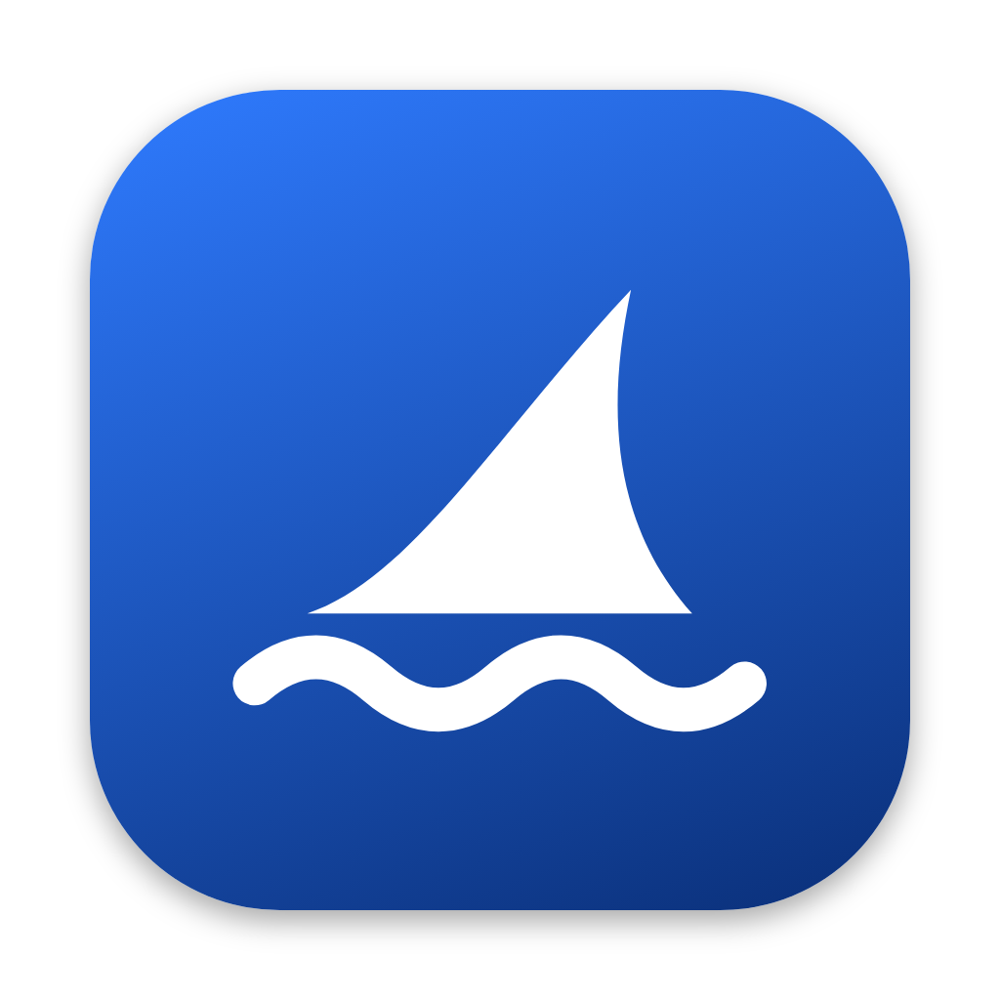

  

<h1 align="center">Mako</h1>

  Ваші задачі з GitLab, GitHub і Jira роблять агенти Claude Code. 
  Ви лише затверджуєте план, відповідаєте на питання й натискаєте «Merge».

  <a href="https://github.com/SergeyPirogov/mako-agent/releases/latest"><b>Завантажити для Mac</b></a> ·
  <a href="docs/features.md">Усі можливості</a> ·
  <a href="docs/development.md">Розробка</a>

---

## Що робить Mako

Mako живе в меню Mac і дивиться у ваш трекер. Щойно на вас призначили задачу, вона з'являється на дошці.
Одна кнопка — і агент уже працює в окремій гілці. Далі Mako веде задачу сам:

1. **Бере задачу.** Клонує репозиторій, створює worktree з гілкою `feature/…` або `fix/…`, запускає Claude Code.
2. **Показує агента.** Чат або термінал прямо на дошці: ви відповідаєте на питання, даєте дозволи, затверджуєте план.
3. **Перевіряє перед MR.** Тести, лінт і збірка в worktree, другий агент читає diff як рецензент, у змінах шукаються
   секрети. MR відкривається лише коли все чисто.
4. **Доводить до мерджу.** Червоний CI, коментарі ревʼюера, конфлікти з main — агент виправляє сам. Після мерджу
   задача закривається в трекері, worktree прибирається.
5. **Вчиться.** Ваші правки агенту стають правилами в `CLAUDE.md`, а статистика показує, що працює: успішність,
   час до MR, вартість по проєктах і моделях.

Дошка є і на телефоні: пуш-сповіщення, відповіді агенту й дозволи зі смартфона.

> Mako — найшвидша акула. Помічає задачу першою і віддає її тому, хто її зробить.

## Встановлення

Потрібні macOS і [Claude Code](https://claude.com/claude-code) (`claude` у `PATH`).

1. Завантажте `Mako-<версія>-mac.zip` з [останнього релізу](https://github.com/SergeyPirogov/mako-agent/releases/latest).
2. Розпакуйте й перетягніть `Mako.app` у `Applications`.
3. Перший запуск — правий клік на `Mako.app` → «Відкрити» (застосунок підписано ad-hoc, тож macOS спершу попередить).
4. Відкриються налаштування: вставте токен трекера, виберіть проєкти — і дошка готова на
   [127.0.0.1:7777](http://127.0.0.1:7777).

Хочете, щоб це зробив агент? Є [готовий промпт для Claude Code](docs/install-with-agent.md).

## Що далі

- **Телефон.** Налаштування → Телефон → QR-код, потім додайте дошку на екран «Додому».
- **Усі можливості** з деталями, налаштуваннями й порадами — у [docs/features.md](docs/features.md).
- **Запуск з коду, збірка, реліз** — у [docs/development.md](docs/development.md).
